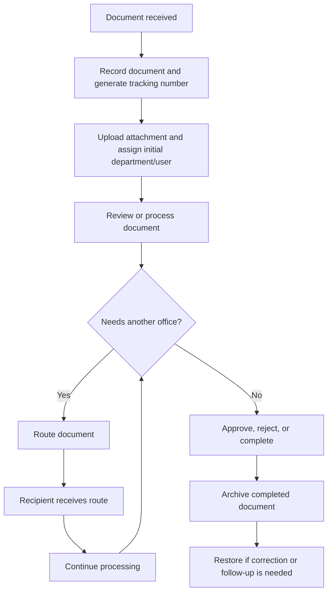

# CLO Document Tracking System
## System Study

## 1. System Overview

The City Legal Office Document Tracking System is a browser-based internal LAN application for receiving, routing, monitoring, archiving, and reporting official documents.

The system provides:

- User registration and account approval
- Role-based page access
- Document receiving and tracking-number generation
- Document assignment and routing between departments
- Receiving of routed documents
- Document status and movement history
- File attachment and version management
- Pending-document monitoring
- Archive and restore functions
- Notifications for routed and received documents
- Reports and dashboard summaries
- Audit-trail recording
- Password recovery using employee number and security questions

The application uses PHP with an MVC-style structure and MySQL/MariaDB through MySQLi prepared statements.

## 2. Objectives

The system is intended to:

1. Create a single record for every incoming document.
2. Give each document a unique tracking number.
3. Show the current status, department, and assigned user.
4. Record every movement of a document between offices.
5. Notify users when documents are routed or received.
6. Restrict pages and operations according to role.
7. Preserve historical information through audit logs and routing timelines.
8. Reduce manual follow-up and lost-document risk.

## 3. Users and Roles

### ADMIN

- Manage users, roles, departments, document types, and system settings.
- View audit trail and reports.
- Access all authorized document functions.
- Configure which pages each role can access.
- Handle administrative password resets manually.

### CITY_ATTORNEY

- Review documents assigned to the legal office.
- Route or process documents according to assigned permissions.
- View tracking information, pending documents, and reports when assigned.

### LEGAL_STAFF

- Process and draft documents assigned to the legal staff.
- View document information and routing history.
- Route or update documents when the assigned page access permits it.

### RECORDS_OFFICER

- Receive and record documents.
- Route documents to departments or users.
- Monitor pending documents.
- Archive and restore documents when permitted.

### DOCUMENT_VIEWER

- Access the dashboard and public/document-tracking functions assigned by the administrator.
- Intended for view-only use.
- Should not receive document-management, routing, archive, or administration access unless explicitly assigned.

> Page access is role-based. A user receives access through the role assigned to the account.

## 4. Main Modules

| Module | Purpose |
| --- | --- |
| Dashboard | Summary counts, trends, recent activity, and quick actions |
| User Management | Create, approve, edit, deactivate, and delete users |
| Role Management | Assign pages to roles |
| Document Management | Receive, update, attach files, replace files, and archive documents |
| Document Routing | Send documents to another department/user and receive routes |
| Document Tracking | Search by tracking number and view the movement timeline |
| Pending Documents | Monitor documents awaiting action or review |
| Archive | Search archived documents and restore them |
| Reports | Generate document and activity reports |
| Audit Trail | Review recorded system actions |
| Department Management | Maintain departments |
| Document Types | Maintain document classifications |
| System Settings | Maintain office/system configuration |
| My Profile | Update personal details, password, profile image, and recovery answers |

## 5. Core Document Flow

## 6. Detailed Business Flow

### 6.1 Account Flow

1. A person registers with employee number, account details, role, department, password, and recovery answers.
2. The first registered account becomes the initial administrator.
3. Later staff registrations are inactive until approved by an administrator.
4. The administrator assigns or changes the user role.
5. Page access is evaluated from the role.
6. The user logs in and sees only assigned pages.

### 6.2 Document Receiving Flow

1. The receiving user opens Document Management.
2. The user records title, description, document type, originating department, current department, priority, confidentiality, dates, and assignee.
3. The system generates a tracking number.
4. The user uploads the document file.
5. The document receives its initial status.
6. The action is recorded in the audit trail.

### 6.3 Routing Flow

1. The sender opens Document Routing.
2. The sender selects a document.
3. The sender selects the destination department and optional recipient.
4. The sender adds remarks and an optional due date.
5. The system creates a route with a pending status.
6. The recipient sees a notification.
7. The recipient opens Document Routing and receives the route.
8. The route status becomes received and the document timeline is updated.

### 6.4 Tracking Flow

1. A user opens Document Tracking.
2. The user searches by tracking number or another supported search value.
3. The system shows current status, current office, assigned user, date received, and route history.
4. Public tracking only exposes documents allowed by the public/confidentiality rules.

### 6.5 Archive Flow

1. A permitted user opens Archive.
2. Completed documents can be archived.
3. Archived documents remain searchable with their historical information.
4. A permitted user may restore a document if further action is required.
5. Archive and restore actions should be audited.

### 6.6 Password Recovery Flow

1. The user submits username/email and employee number.
2. Active non-admin users receive one randomly selected security question.
3. The user submits the answer.
4. The system verifies the answer using the stored hash.
5. A valid answer creates a temporary reset token.
6. The user sets a new password.
7. Failed attempts are counted and locked after the configured limit.
8. Admin self-service password reset is routed to IT or another administrator.

## 7. Access-Control Design

The system has two layers:

1. Authentication: confirms the user is logged in and active.
2. Authorization: confirms the user's role can access the requested page.

The page map has safe defaults. Database assignments can override the default page list for a role. The Roles page is administrator-only.

The dashboard is important because it is the normal post-login destination. Non-admin roles should always have dashboard access assigned. The application also protects against redirect loops if dashboard authorization fails.

## 8. Data and Audit Design

Important database areas include:

- `users`: account identity, role, department, and password data
- `roles`: available user roles
- `departments`: organizational offices
- `documents`: document master records and current state
- `attachments`: uploaded document files
- `document_routes`: movement between offices/users
- `document_history`: status changes
- `audit_logs`: security and business activity history
- `user_security`: security answers and password-reset lockout state
- `page_access`: role-to-page assignments
- notification tables: notification read and dismissal state

The `user_security` table is a one-to-one extension of `users`. It keeps recovery and lockout data separate from normal account data.

## 9. Controls and Safeguards

Current controls include:

- Prepared MySQLi statements
- Password hashing
- Session ID regeneration after login
- HttpOnly and SameSite session cookies
- Session timeout
- CSRF tokens on protected forms
- Role-based page checks
- Password-recovery security questions
- Account-level reset lockout
- Audit logging
- Real-path checks for served attachments

## 10. Recommended Operational Controls

Before production use, prioritize:

1. Enforce document-level authorization for confidential documents.
2. Restrict attachment downloads by document assignment, department, or role.
3. Apply identical MIME, extension, size, and content checks to every upload path.
4. Disable script execution in upload directories.
5. Make reset-token consumption atomic.
6. Validate role-management requests with CSRF and transactions.
7. Review audit logs regularly.
8. Back up the database and uploads directory.
9. Test restore procedures.
10. Use a trusted `APP_URL` for LAN deployment.

## 11. Expected Benefits

- Faster document retrieval
- Clear accountability for every movement
- Fewer misplaced documents
- Better visibility of pending work
- Controlled access to confidential information
- Searchable historical records
- Easier reporting and compliance review
